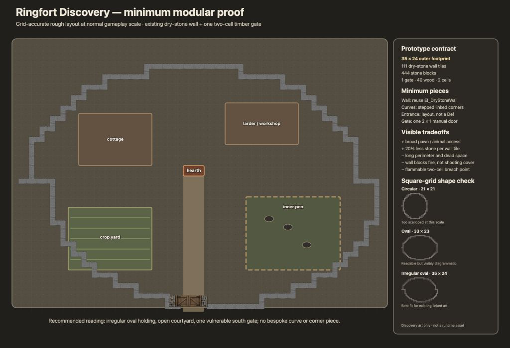

# Ringfort Foundations Discovery

**Status:** Revision required — Gate A (Ringfort Worth Building) unmet<br>
**Recommendation:** No go for a required circular or oval perimeter; retain the developer gate as a technical prototype while the settlement decision is revised<br>
**Owner and gameplay approver:** Patrick Mee<br>
**Prepared:** 2026-08-30<br>
**Revised:** 2026-10-17 after maintainer gameplay challenge<br>
**Milestone:** Version 0.8 — Ringfort Foundations<br>
**Authority:** [Approved Version 1.0 delivery plan](version-1.0-delivery-plan.md)<br>
**Discovery baseline:** RimWorld 1.6.4871 rev597, installed source and build<br>
**Feature record:** Maintainer's Ringfort Discovery delegation and this decision record<br>

## Decision

**Revise before implementation.** Reject a separate ringfort wall family, bespoke
curve or corner Defs, and a standalone entrance piece. The tested minimum kit is:

1. the released `EI_DryStoneWall`, unchanged;
2. stepped cardinal links for round, oval, and mildly irregular enclosure plans;
3. an entrance made by the player's layout, not by another Def; and
4. one manual two-cell timber gate, implemented with RimWorld's native
   `Building_MultiTileDoor` behavior.

This kit has **not** passed Gate A of the approved delivery plan. A player can use
the same wall and two-cell gate in a rectangular enclosure with easier placement
and more usable interior cells. RimWorld's wall, pen, room, and raid systems assign
no benefit to roundness. The gate's access and breach tradeoff is real, but it is
independent of the perimeter shape. Normal-zoom readability alone cannot turn an
oval into a gameplay decision. Patrick's 2026-10-17 question exposed this gap;
the earlier conditional-go recommendation was too strong. Discovery does not
approve the gameplay slice, final balance, public Def name, text, or runtime art.

The broader kit is disproved at this scale. It would duplicate the released wall's
mechanics and compatibility contract, while special curve pieces would not remove
the square grid and would multiply art, placement, and linking states. A native
two-cell gate is the only new piece that changes the player's ordinary verbs:
access is broader and cheaper than two wooden doors, but one flammable, lower-total-
durability object opens a two-cell breach when it fails.

## Player Decision and Visible Tradeoffs

The player can spend less stone but more construction labor on a holding perimeter
that encloses an outdoor courtyard, crops, animals, work, and storage. Full walls
block movement, sight, and shooting rather than acting as shoot-over cover. The
timber gate is an obvious fire and breach focus. These are choices between the
released wall, vanilla pieces, and the prototype gate; none requires a ring shape.

On RimWorld's cardinal grid, a rounded perimeter needs more planning and awkward
steps to enclose comparably useful rectangular work and crop spaces. No verified
native system compensates for that cost. Until a small, native, player-visible
settlement benefit is demonstrated, a required oval would be an aesthetic tax.

The choice is not an automatic upgrade:

- choose the dry-stone wall and prototype gate for material-efficient perimeter
  definition, broad access, and a protected open holding in any suitable shape;
- choose vanilla walls for greater segment durability and lower construction labor;
- choose two vanilla doors for independent one-cell failures and greater combined
  hit points; or
- choose barricades or a mixed defense when shoot-over cover and compact combat
  geometry matter more than a sealed settlement enclosure.

No global defense modifier or special raid behavior supplies this distinction. The
material, work, footprint, access, cover, fire, and breach tradeoffs support the
pieces individually but do not yet support a distinct ringfort feature. One
possible revision is a terrain-following, irregular fortified holding with the
oval shown only as an example; that still needs a convincing reason to choose the
settlement form over an ordinary rectangular base. Otherwise reject this candidate
and revisit the approved marquee promise with Patrick.

## Research Finding

No new historical research was required. The approved
[Dry-Stone Wall research brief](../research/version-0.1/dry-stone-wall.md) already
resolves the relationship needed here:

- cashels were stone-walled settlement enclosures and raths were earth-banked
  enclosures;
- both could bound domestic space containing dwellings, livestock, craft, and
  storage;
- the enclosure could protect a household and be defensible without being a
  purpose-built castle; and
- form, diameter, wall mass, status, and defensive value varied too much for one
  monumental survivor to stand for an ordinary holding.

The gameplay translation is therefore a **cashel-inspired settlement relationship**:
perimeter, entrance, open courtyard, domestic work, food production, and animals.
It is not a reconstruction of a named monument, a claim that all ringforts were
stone, or an archaeological gate reconstruction. The rough gate is original fantasy
game art constrained by the established Emerald Isle stone language.

## Installed RimWorld 1.6 Verification

The following was checked against the installed 1.6.4871 rev597 source, Core Defs,
and `Assembly-CSharp.dll`, rather than memory or a prior game revision. Paths below
are relative to the installed RimWorld app's `Source`, `Data`, and managed-assembly
roots.

| Concern | Verified native behavior | Ringfort consequence |
|---|---|---|
| Wall and linking | Core `Wall` is a full-fill, impassable, room/roof-supporting, light- and wind-blocking building. `EI_DryStoneWall` already inherits it and uses `Graphic_LinkedCornerFiller` with the 16 cardinal neighbor states. | Reuse the released wall. Stepped links supply every required cardinal corner; no curve Def is justified. |
| Gate placement | Core supplies `Building_MultiTileDoor`, `PlaceWorker_MultiCellDoor`, `DoorUtility.WallRequirementCells`, and `EncapsulatingWallAt`. Core's two-cell ornate door proves the native seam. A multi-cell door becomes stuck open without valid flanking support walls. | A 2 x 1 XML gate is feasible with normal placement and wall supports. The entrance remains a two-cell gap in the plan. |
| Pawn pathing | `Building_Door` opens through normal pawn jobs, applies `DoorOpenSpeed`, clears reachability caches when state changes, auto-closes after friendly use, and supports hold-open. It evaluates every occupied cell for a multi-cell door. | No pathing code is needed. Opposing traffic and congestion still require an in-game check. |
| Rooms, roofs, and temperature | `DoorBase` participates in normal enclosure, roof, wind, light, and temperature behavior. An open door exchanges temperature; a supported closed door is a barrier. | The gate should seal like a normal door. A roofed-room test must catch support, stuck-open, room-region, or temperature regressions. |
| Pens and animals | Ordinary fence-blocked animals cannot open normal doors unless roped to a pawn that can open them. Fence gates instead opt into `roamerCanOpen` and pen behavior. | The candidate is a settlement door, not a fence gate. Closed, held-open, penned, and roped-animal behavior must be observed in-game. |
| Cover | Full walls block lines of fire. Core barricades and sandbags use `FillPercent` 0.55 for shoot-over cover and remain traversable; the wall does not become a stronger barricade. | The ring wall protects by obstruction. Players must add ordinary cover where they want firing positions. |
| Fire | Stone wall Stuff provides the existing nonflammable behavior. `Building_Door.FireBulwark` applies while closed. The prototype gate deliberately has flammability 1. | Fire should leave the wall standing while making the entrance a visible liability; ignition and destruction need an in-game check. |
| Repair and removal | Walls and doors remain ordinary buildings discoverable by vanilla repair, deconstruction, reconstruction, and building listers. | No special maintenance or refund loop. Test partial damage, repair, total gate loss, reconstruction, and removal. |
| Breach and raids | The installed build contains the ordinary breaching grid, breaching job giver, breaching utilities, sappers, and breaching raid strategies. Walls retain their native bomb/thump damage factor. | Do not patch raid AI. Ordinary attacks and one breaching raid must demonstrate useful but non-guaranteed targeting and a real two-cell failure. |
| Save state | `Building_Door` saves open, hold-open, timing, and related native state. A public Def would become a save and compatibility contract. | Keep `EI_Dev_RingfortGatePrototype` in the developer companion mod during discovery. Save/reload the gate before any public Def is approved. |

### Prototype Technical Proof

`Dev/Mod/Defs/ThingDefs_Buildings/EI_Dev_RingfortPrototype.xml` contains one
developer-only Def:

- parent `DoorBase`;
- class `Building_MultiTileDoor`;
- size `(2, 1)`, rotatable;
- `PlaceWorker_MultiCellDoor`;
- 40 fixed wood, 1,000 work, 120 hit points, 115% door speed, and flammability 1;
- Core ornate-door graphics solely to isolate mechanics during discovery.

It is not staged by the public package, does not create an `EI_` runtime contract,
and is not final balance or art. The public staging validator passes with the
developer Def absent. The developer staging validator also passes.

Patrick reported in-game on 2026-10-17 that the gate opens and closes in a straight
wall with supports. The remaining placement, room, pen, raid, damage, persistence,
and visual checks have not been reported as passed.

No C# or Harmony is justified. Final implementation can remain XML plus original
textures and localization. If native multi-cell door behavior fails any acceptance
check, revise or reject this slice rather than adding a custom building framework.

## Comparison Against Vanilla and the Released Wall

Displayed work and hit points below apply the installed Stuff factors. Granite
blocks have a material input value of 0.36 each; wood has an input value of 1.20.
Final building wealth remains RimWorld's engine-derived stat and has no override.
The in-game test must record that final value; input values are included so discovery
does not pretend to know an unverified runtime result.

| Piece | Material and input value | Displayed work | Durability | Cover and enclosure | Footprint, access, and breach lifecycle |
|---|---:|---:|---:|---|---|
| Granite vanilla wall | 5 blocks / 1.80 | 1,650 | 510 HP | Full obstruction; normal room, roof, wind, light, and temperature barrier | One impassable cell; one-cell breach; native bomb/thump vulnerability |
| Granite `EI_DryStoneWall` | 4 blocks / 1.44 | 2,040 | 408 HP | Same full-wall behavior; not shoot-over cover | One impassable cell; 20% less material and durability, about 24% more work than vanilla |
| Wooden vanilla door | 25 wood / 30.00 | 595 | 104 HP | Full door barrier while closed | One cell; 120% Stuff-adjusted door speed; one-cell failure |
| Wooden vanilla fence gate | 25 wood / 30.00 | 350 | 13 HP | Pen access, not a wall-door substitute | One cell; native animal-roamer behavior; extremely weak breach point |
| Granite barricade | 5 blocks / 1.80 | 2,760 | 510 HP | 55% shoot-over cover; does not seal a room | One traversable cell with path cost 42; normal fence/pen boundary role |
| DEV ringfort gate | 40 fixed wood / 48.00 | 1,000 | 120 HP | Native closed-door barrier; flammable | One 2 x 1 object; 115% speed; destruction exposes both cells |

Two adjacent wooden vanilla doors cost 50 wood with 1,190 total work and 208
combined hit points. The prototype gate costs 10 less wood and 190 less work, but
has 88 fewer combined hit points and makes both cells fail together. That is the
minimum gate decision; final values should move only if the in-game experience does
not make both the benefit and liability obvious.

The rough 35 x 24 proof uses 111 wall tiles plus one two-cell gate:

| Complete perimeter | Material input | Construction work | Segment or gate liability |
|---|---:|---:|---|
| Ringfort candidate | 444 granite blocks + 40 wood; input value 207.84 | 227,440 | 408 HP wall segments; one 120 HP two-cell gate |
| Same plan with vanilla wall and two wooden doors | 555 granite blocks + 50 wood; input value 259.80 | 184,340 | 510 HP wall segments; two independent 104 HP doors |

The ringfort therefore saves material and expected wealth input while demanding
substantially more wall labor, losing segment durability, and concentrating entrance
failure. Its broad perimeter and courtyard also consume more map area than a compact
vanilla defense. Actual construction wealth is an explicit in-game acceptance datum,
not a static claim. These figures compare two material choices on the **same**
outline. They do not show why that outline beats a simpler rectangular plan.

## Layout and Art Proof



The reproducible vector source is
[ringfort-layout-proof.svg](../art/prototypes/ringfort/ringfort-layout-proof.svg),
generated by
[render-layout.py](../art/prototypes/ringfort/render-layout.py). It embeds the
released dry-stone wall atlas and a temporary gate concept, draws every wall on the
42-pixel gameplay grid, and uses the exact cardinal atlas state for each link.

The proof compares three readings:

- a regular 21 x 21 circle is too visibly scalloped;
- a regular 33 x 23 oval is readable but diagrammatic; and
- a mild 35 x 24 irregular oval is the best match for the existing linked art.

The selected plan has a 113-cell perimeter: 111 walls and a two-cell south gate.
The existing corner treatment remains legible when straight runs vary and direction
changes are distributed. Bespoke arcs would add false smoothness to a cardinal grid;
they are excluded. Acceptance is about the normal-zoom settlement silhouette, not
pixel-perfect circularity. This is an art and layout proof only; it does not prove
that a player benefits from constructing the shape.

### Temporary Art Provenance

`ringfort-gate-concept-source.png` is a project-bound discovery source, not a runtime
asset. It was generated with OpenAI ImageGen on 2026-08-30 using the released
`EI_DryStoneWall_Atlas.png` as a material-language reference. The art direction was:

> Temporary stylized RimWorld concept sprite for a two-cell timber ringfort gate
> between low dry-stone jambs; straight double gate, landscape 2:1, muted brown and
> cool gray, transparent background, no arch, tower, battlements, text, scenery, or
> polished final detail.

A second extraction pass removed the generated checkerboard and preserved the gate
on true alpha. The normal-zoom proof was rendered in the in-app browser because the
platform thumbnail renderer cropped the right comparison panel. If the slice passes,
all final mover, top, support, blueprint, and menu textures must be original,
directionally complete, and reviewed through the normal art workflow.

## Candidate Final Scope If Gate A Is Later Met

1. Reuse `EI_DryStoneWall` without changing its Def, stats, localization, texture
   paths, or save contract.
2. Add one public, rotatable 2 x 1 manual timber gate using native
   `Building_MultiTileDoor` and `PlaceWorker_MultiCellDoor`.
3. Supply original directionally complete mover, top, support, blueprint, and menu
   art that shares the dry-stone wall's grounded silhouette and avoids castle imagery.
4. Add only the gate's name, description, and required construction-menu placement.
5. Document one example irregular-oval layout and the gate's material, labor, fire,
   and two-cell-breach tradeoff.
6. Add affected-path validation and the in-game evidence required by Gate B of the
   delivery plan.

The final public Def name, values, copy, and art paths become compatibility contracts
only after Patrick approves the slice. The development Def must not be renamed into
the public package or included in a release.

## Exclusions

- no new wall, corner, curve, end-cap, doorway, tower, or decorative variant Def;
- no procedural generation, automatic layout, or custom drawing interface;
- no multi-level maps, simulated elevation, or vertical-combat fiction;
- no special raid AI, global defense bonus, or killbox automation;
- no new pen, room, roof, temperature, repair, or breach rule;
- no governance, hospitality, ritual, faction, or broad architecture framework;
- no round tower work; and
- no public compatibility contract until the discovery gate is approved.

## Optional In-Game Technical and Visual Check

The gate's remaining technical checks can continue independently. Building the
complete 35 x 24 oval is **not required** to decide that the present ringfort pitch
fails Gate A. Use the larger setup below only if comparing settlement silhouettes
would help evaluate a revised concept.

### Setup

1. From this branch, stage the public mod and developer companion mod into two
   dedicated local test destinations. Do not copy the developer files into the
   public destination:

   ```sh
   ./tools/stage-mod.sh /path/to/test/Mods/EmeraldIsle
   ./tools/stage-dev-mod.sh /path/to/test/Mods/EmeraldIsleDevTools
   ```

2. Start RimWorld 1.6.4871 rev597 with Core, Emerald Isle, and Emerald Isle Dev
   Tools enabled. Use Development mode and a disposable map with construction
   resources available.
3. Build the 35 x 24 irregular proof in granite, placing
   `DEV ringfort gate prototype` in the two-cell south opening with valid walls at
   both ends. Add a small roofed test room using the same gate separately; the large
   holding itself remains an open courtyard.
4. Keep a comparator nearby: five granite vanilla walls, five granite dry-stone
   walls, two adjacent wooden doors, one wooden fence gate, and five granite
   barricades. Open each information card and record final Market Value,
   Work To Build, Max Hit Points, Flammability, and Door Open Speed where shown.

### Short Checklist

- [ ] At ordinary gameplay zoom and without reading labels, the full layout reads
      as one inhabited ring or oval holding rather than a jagged square wall or a
      castle.
- [ ] The gate reads immediately as the entrance and shares the dry-stone wall's
      visual language without reading as a monumental arch or field-fence gate.
- [ ] Two pawns using opposite directions and one handler with a roped pen animal
      traverse the gate without errors or unacceptable congestion.
- [ ] A pen marker inside the perimeter reports the expected closed/held-open state;
      an unroped fence-blocked animal cannot open the ordinary gate by itself.
- [ ] The separate roofed room forms correctly; the gate is not unexpectedly stuck
      open; closed/open temperature behavior matches a native door after save/load.
- [ ] Colonist fire treats walls as obstructions, barricades as shoot-over cover,
      and the open gate as a real two-cell lane with no phantom cover.
- [ ] Igniting the gate demonstrates a timber liability without igniting the granite
      wall; a closed gate acts as an ordinary fire bulwark until it opens or fails.
- [ ] Damage to both wall types and the gate can be repaired normally. Destroying
      the gate creates a two-cell breach; rebuilding and deconstruction work through
      normal construction jobs and refunds.
- [ ] One ordinary hostile raid and one vanilla breaching or sapper raid use normal
      pathing and attack behavior, with no recurring log error or guaranteed special
      targeting benefit.
- [ ] Save and reload once with the gate damaged and held open, and once closed.
      State, room, pen, path, and repair behavior remain correct.
- [ ] A rational vanilla or mixed-material alternative remains apparent after the
      final wealth values are recorded.

### Acceptance Rule

Choose **go** only if every behavior check passes and Patrick answers yes to all five
questions:

1. Is the irregular plan recognizable as a lived-in ringfort holding at normal zoom?
2. Is broad access worth a visibly weaker, flammable two-cell breach point in at
   least one real colony situation?
3. Would a reasonable player sometimes prefer vanilla walls, two doors, barricades,
   or a mixed plan instead?
4. Can the final scope remain exactly one existing wall plus one XML gate without
   bespoke curves or code?
5. When built for the same colony need, does the proposed settlement form offer a
   visible advantage that a straightforward rectangular wall and the same gate do
   not offer? If the answer is only appearance, Gate A remains unmet.

The current answer to question 5 is **no**, so the present candidate remains
**revise / no go** even if every technical check passes. Choose **revise** if a
bounded, native settlement decision can be demonstrated. Choose **reject** if the
plan remains only a visual theme, the native gate misbehaves, or coherent reading
requires extra wall pieces, custom code, or excluded systems.

A revised settlement decision, its direct comparison with a practical rectangular
plan, and Patrick's explicit approval are the remaining discovery gate. Permanent
gameplay implementation must not begin before that approval.
